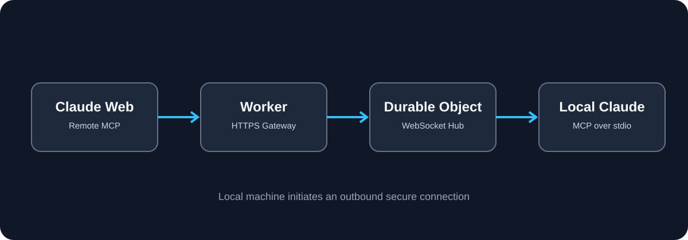

# Claude Code Bridge



**Connect a remote MCP client to the Claude Code MCP server running on your own computer, using Cloudflare Workers as a secure relay.**

[Architecture](docs/ARCHITECTURE.md) · [Deployment](docs/DEPLOYMENT.md) · [Protocol](docs/PROTOCOL.md) · [Security](SECURITY.md)

## Overview

Claude Code Bridge is a self-hosted bridge for a specific workflow: Claude Web (or another compatible remote MCP client) sends MCP requests to a Cloudflare Worker, and the Worker relays them over an outbound WebSocket connection to a local agent. The local agent forwards JSON-RPC messages to the real `claude mcp serve` process.

The Worker does **not** run Claude Code. The local computer does. Your local Claude Code environment, project files, installed tools, and permission settings remain on your machine.

## Architecture

```text
Remote MCP client
      | HTTPS + Bearer token
      v
Cloudflare Worker (/mcp)
      |
      v
Durable Object (request correlation)
      | persistent WSS connection
      v
Local Node.js agent
      | stdio JSON-RPC
      v
claude mcp serve
      |
      v
Local projects and tools
```

## Repository contents

| Path | Purpose |
| --- | --- |
| `worker/` | Cloudflare Worker and Durable Object relay |
| `agent/` | Local Node.js WebSocket-to-stdio agent |
| `docs/` | Architecture, deployment, protocol, troubleshooting |
| `assets/` | Architecture and component SVG illustrations |

## Quick start

### Requirements

- Cloudflare account with Workers and Durable Objects.
- Node.js 20+ and npm.
- Claude Code installed, authenticated, and providing `claude mcp serve`.
- A remote MCP client with support for HTTP remote servers and bearer authentication.

### 1. Deploy Cloudflare Worker

```bash
cd worker
npm install
npx wrangler login
npx wrangler secret put BRIDGE_TOKEN
npx wrangler deploy
```

Save the deployed Worker hostname. Your MCP URL is:

```text
https://YOUR-WORKER.workers.dev/mcp
```

### 2. Configure and start the local agent

In a second terminal:

```bash
cd agent
npm install
```

Set the environment variables:

**macOS / Linux**
```bash
export BRIDGE_AGENT_URL="wss://YOUR-WORKER.workers.dev/agent"
export BRIDGE_TOKEN="the-same-secret-used-on-Cloudflare"
npm start
```

**Windows PowerShell**
```powershell
$env:BRIDGE_AGENT_URL = "wss://YOUR-WORKER.workers.dev/agent"
$env:BRIDGE_TOKEN = "the-same-secret-used-on-Cloudflare"
npm start
```

Leave the local agent running. It launches `claude mcp serve` and connects to the Worker.

### 3. Connect your remote MCP client

In the client's remote MCP connector settings, add:

- **Server URL:** `https://YOUR-WORKER.workers.dev/mcp`
- **Authentication:** Bearer token
- **Token:** the value configured as `BRIDGE_TOKEN`

Claude Web's availability of custom remote MCP connectors and its authentication options can vary by product, account, and rollout. If the setting is not available in your account, this project cannot enable it; use another MCP client that supports remote HTTP MCP.

### 4. Check the Worker

```bash
curl https://YOUR-WORKER.workers.dev/health
```

This checks the Worker process only. A successful MCP tool call additionally requires the local agent to be connected.

## Security

This bridge can expose powerful local development tools to whoever possesses the bearer token. Use a long random secret, HTTPS/WSS, a restricted local OS account, and Claude Code's permission controls. Never commit `.env` files or paste tokens into issues.

This initial version is a single-agent relay. It does not include multi-user identity, a per-tool approval dashboard, audit storage, or SSE streaming. Review [SECURITY.md](SECURITY.md) and [the limitations](docs/PROTOCOL.md) before production use.

## Documentation

- [Architecture and trust boundaries](docs/ARCHITECTURE.md)
- [Step-by-step deployment](docs/DEPLOYMENT.md)
- [MCP transport behavior and limitations](docs/PROTOCOL.md)
- [Troubleshooting](docs/TROUBLESHOOTING.md)
- [Contributing](CONTRIBUTING.md)
- [Security policy](SECURITY.md)

## License

MIT — see [LICENSE](LICENSE).
